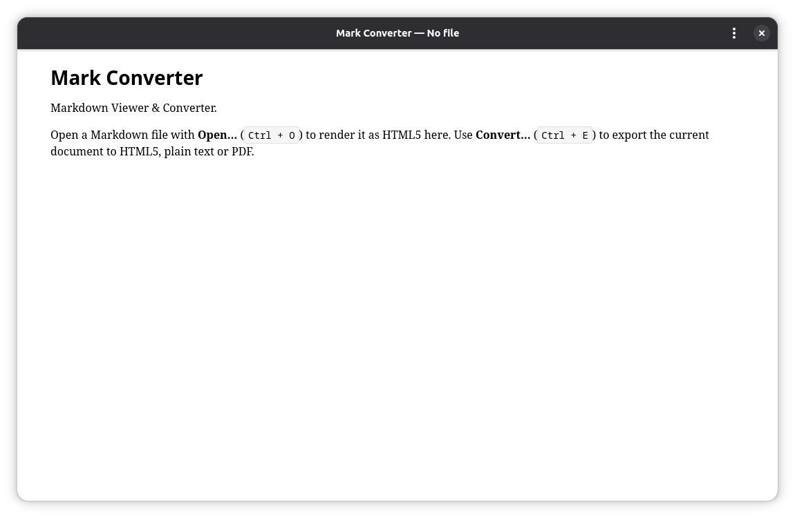

# Mark Converter



Markdown Viewer & Converter is a simplified version of Mark Editor [Mark Editor](https://github.com/nobus-1967/mark_editor).

Mark Converter is **not an editor**: it opens a Markdown file, converts it to styled HTML5 with [markdown2html5-base](https://github.com/nobus-1967/markdown2html5-base), and shows the result immediately in a WebKitGTK window. The window has no menu bar — only a hamburger menu with five commands.

## Functions

- open `.md` / `.markdown` files from a command line, a file manager or the **Open...** dialog;
- render Markdown as HTML5 in the built-in viewer at startup and on every open;
- export the current document to HTML5, plain text or PDF (portrait/landscape) — `Convert...` logic from Mark Editor 1.1.0, with a single HTML5 option;
- toggle light/dark theme instantly and persist the choice;
- show **About** with version `0.1.0 (2026.11)`;
- clean up the temporary HTML file when the window closes.

## Commands

All commands live in the hamburger menu (no menu bar).

| Command      | Shortcut         |
| :---         | :---             |
| Open...      | `Ctrl + O`       |
| Convert...   | `Ctrl + E`       |
| Toggle Theme | `Ctrl + Alt + G` |
| Quit         | `Ctrl + Q`       |
| About        | —                |

### Convert...

The format list and export behavior are kept from Mark Editor 1.1.0:

1. `HTML5 file (.html)` — portrait CSS embedded;
2. `Plain text file (.txt)` — Markdown syntax stripped by `md_to_plain()`;
3. `PDF file portrait (.pdf)`;
4. `PDF file landscape (.pdf)` — landscape CSS is applied to the temporary
   HTML5 file before printing, but no landscape HTML file is offered.

PDF export writes a temporary styled HTML5 file named after the source document (or `~~<name>.html` if that name is taken), prints it with headless
Chromium, then removes the temporary file. The file chooser suggests the name of the currently viewed document with the target extension.

## Code Base

```
mark_converter/
  __init__.py      # Package marker
  main.py          # Entry point
  application.py   # Gtk.Application: actions and keyboard shortcuts
  window.py        # Menu-only window, open/load and Convert... logic
  viewer.py        # WebKitGTK view backed by a temporary HTML5 file
  dialogs.py       # Format choice, About and message dialogs
  constants.py     # Application metadata and cache/config paths
  helpers.py       # theme, temp HTML, markdown2html5-base and PDF export
```

## Configuration and temporary files

- Theme: `~/.config/mark_converter/theme.json`
- Temp HTML without an opened file: `~/.cache/mark_converter/Temp.html`
- Temp HTML for an opened file: `<file's folder>/~<stem>.html`

The temp HTML is rewritten on every open and deleted when the viewer closes. It is kept beside the source file so relative image links still resolve.

## Requirements

- Python >= 3.10
- GTK 4 (>= 4.12)
- libadwaita 1 (>= 1.4)
- WebKitGTK 6.0 (GIR typelib `WebKit-6.0`)
- PyGObject >= 3.50
- markdown2html5-base >= 1.0.0
- Chromium (headless PDF printing)

## Running the Application

```bash
cd application

# Empty viewer with the startup page
python3 -m mark_converter.main

# Open a Markdown file immediately
python3 -m mark_converter.main document.md
```

## Packages

```bash
python3 -m build --outdir dist
```

Produces `dist/mark_converter-0.1.0-py3-none-any.whl` and `dist/mark_converter-0.1.0.tar.gz`.

## Building AppImage

```bash
python3 build_appimage.py
```

Output: `MarkConverter-0.1.0-x86_64.AppImage`

## Tests

```bash
python3 -m unittest test_converter.py -v
```

## License

MIT — see [LICENSE](./LICENSE).
